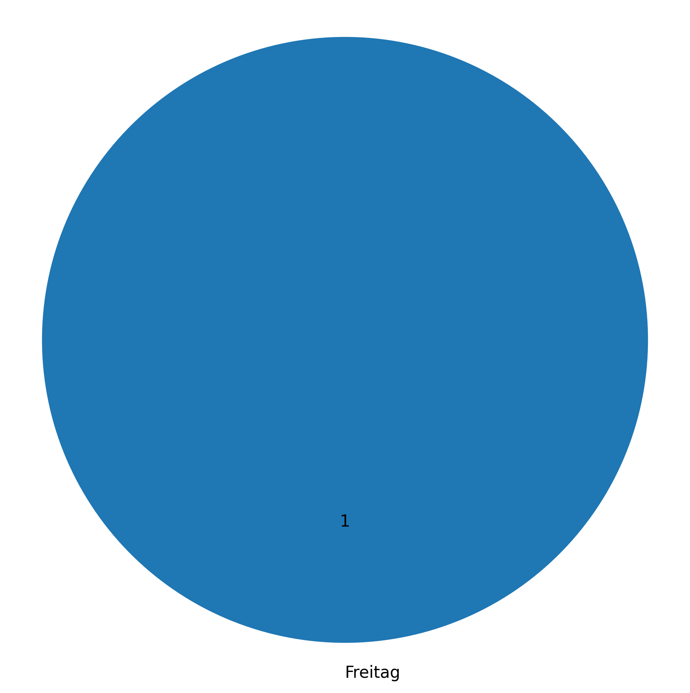
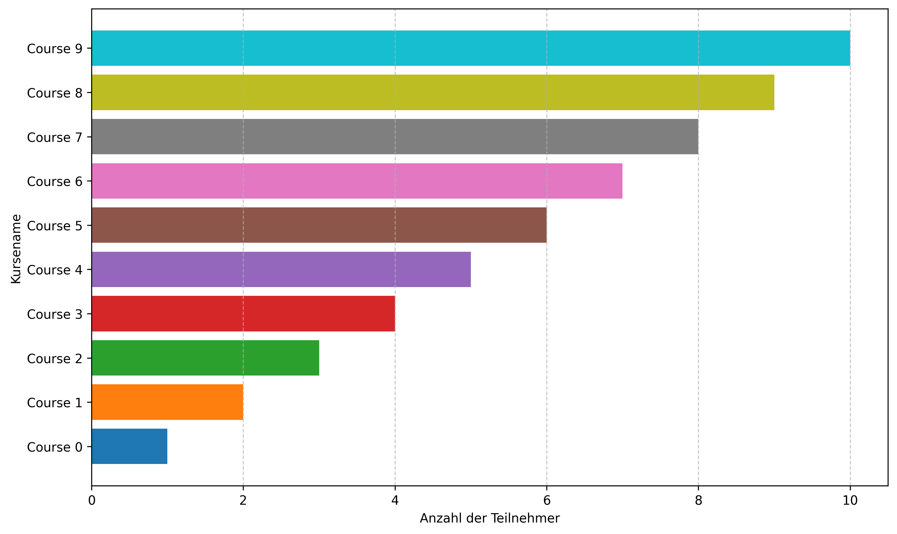
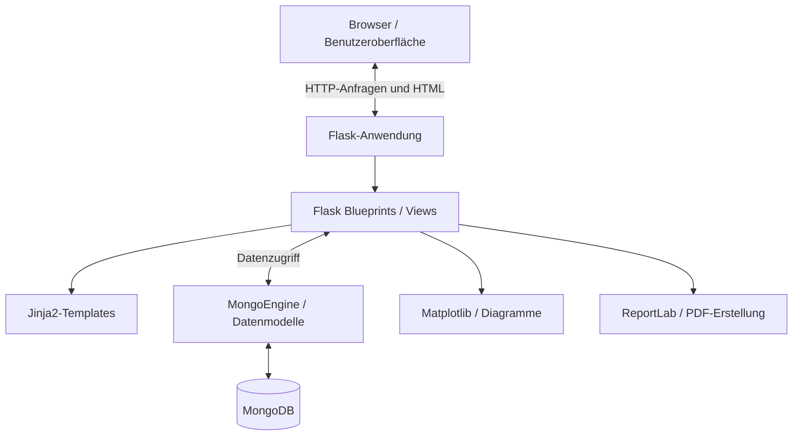
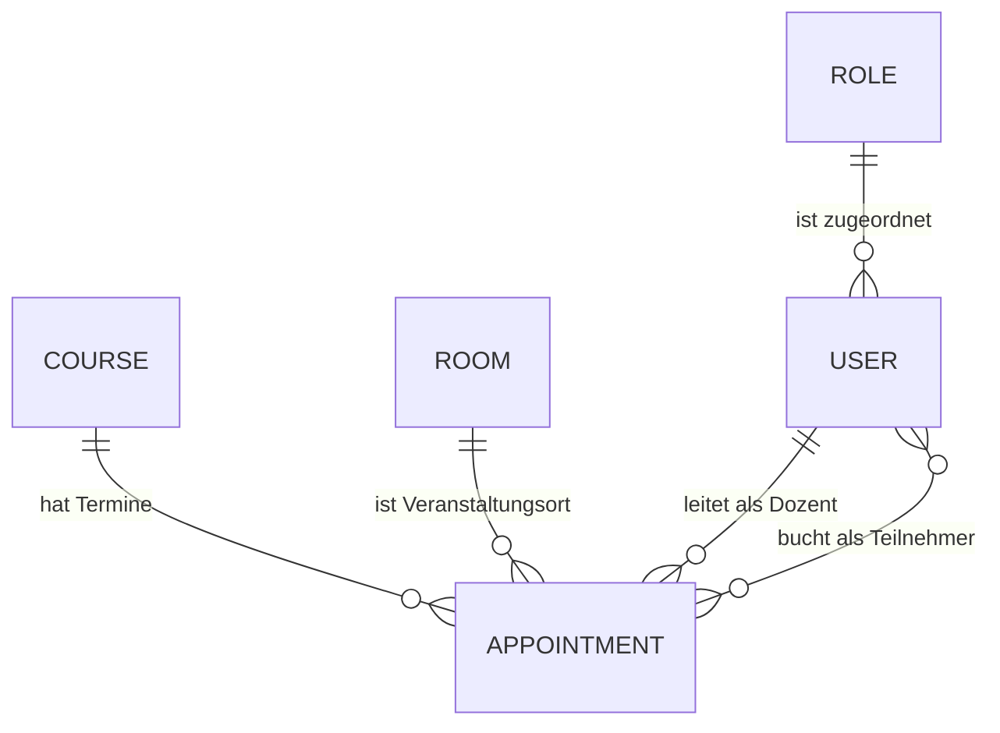

# Course Management System – Kursverwaltungsportal

Eine datenbankgestützte Webanwendung zur Organisation, Verwaltung und Buchung von Kursen. Das System verbindet die Kurs- und Terminverwaltung, die Anmeldung von Teilnehmenden sowie statistische Auswertungen in einem zentralen Portal.

Das Projekt entstand im Rahmen eines Softwarepraktikums im Informatikstudium an der Hochschule Kempten (2025) und wurde als Teamprojekt umgesetzt.

## Projektziel

Ziel war die Entwicklung einer Webanwendung, die den organisatorischen Aufwand bei der Durchführung von Kursen reduziert. Administratoren können Kurse und Termine verwalten, Dozenten ihre zugewiesenen Termine einsehen und Teilnehmende eigenständig Kurse buchen. Dabei werden unter anderem Raumbelegungen, Terminkonflikte und Teilnehmerkapazitäten berücksichtigt.

## Funktionsumfang

Die Oberfläche unterscheidet zwischen drei Benutzerrollen:

| Administrator | Dozent | Teilnehmer |
| --- | --- | --- |
| Benutzer anlegen und bearbeiten | Eigene Termine einsehen | Kurstermine durchsuchen |
| Benutzer aktivieren und deaktivieren | Termine nach Zeitraum filtern | Kurse buchen und abmelden |
| Kurse erstellen und bearbeiten | Teilnehmerlisten einsehen | Eigene Buchungen einsehen |
| Termine planen und stornieren | | Teilnahmebestätigung als PDF abrufen |
| Statistische Auswertungen erstellen | | |

### Kurs- und Terminverwaltung

- Erstellung und Bearbeitung von Kursen mit Namen und Beschreibung
- Prüfung auf leere Eingabefelder und doppelte Kursnamen
- Planung von Kursterminen mit Datum, Raum, Dozent und maximaler Teilnehmerzahl
- Prüfung auf bereits belegte Räume und zeitliche Konflikte bei Dozenten
- Stornierung von Kursterminen

### Buchungssystem

- Übersicht über zukünftige Kurstermine mit verfügbaren Plätzen
- Anmeldung zu Kursen und Übersicht über eigene Buchungen
- Prüfung auf ausgebuchte oder stornierte Termine sowie weitere Buchungen am selben Tag
- Abmeldung von Kursen unter Berücksichtigung des Termindatums
- Generierung von Teilnahmebestätigungen als PDF für nicht stornierte Termine, deren Datum erreicht wurde

### Benutzerverwaltung und Anmeldung

- Anmeldung und Abmeldung mit Flask-Login
- Drei Benutzerrollen: `Admin`, `Teacher` und `User`
- Rollenabhängige Navigation
- Suche und Filterung von Benutzern nach Benutzername und Rolle
- Verwaltung von Benutzerdaten und Kontostatus
- Speicherung von Passwörtern als Hashwerte mit Werkzeug

### Statistische Auswertungen

Mit Matplotlib werden aus den gespeicherten Termindaten zwei Arten von Diagrammen erzeugt:

| Verteilung der Kurstermine nach Wochentagen | Teilnehmerzahlen pro Kurstermin |
| --- | --- |
| Monat und Jahr auswählbar | Jahr auswählbar |
|  |  |

*Beispieldiagramme aus dem Projekt-Repository.*

## Verwendete Technologien

| Bereich | Technologien |
| --- | --- |
| Backend | Python, Flask |
| Frontend | HTML, CSS, JavaScript, Bootstrap, Jinja2 |
| Datenbank | MongoDB, MongoEngine |
| Authentifizierung und Sessions | Flask-Login, Flask-Session, Werkzeug |
| Formulare | Flask-WTF, WTForms |
| Datenvisualisierung | Matplotlib |
| PDF-Erstellung | ReportLab |
| Tests | pytest, Flask Test Client |
| Versionsverwaltung | Git, GitLab |

## Softwarearchitektur

Die Anwendung verwendet das Flask Application Factory Pattern und ist mithilfe von Flask Blueprints in fachliche Module unterteilt. Die serverseitigen Views verarbeiten Anfragen, führen die Anwendungslogik aus und greifen über MongoEngine auf die MongoDB-Datenbank zu. Jinja2-Templates erzeugen die HTML-Oberfläche.



### Datenmodell

Ein `Appointment` (Kurstermin) verbindet einen Kurs, einen Raum, einen Dozenten und eine Liste von Teilnehmenden. Kursbeschreibung und konkrete Terminplanung sind dadurch getrennt modelliert.



## Projektstruktur

```text
course-management-system/
├── app/
│   ├── appointment/           # Datenmodell für Kurstermine
│   ├── bookings/              # Kursbuchungen und Teilnahmebestätigungen
│   ├── course/                # Datenmodell für Kurse
│   ├── course_management/     # Kursverwaltung
│   ├── dozent/                # Dozentenansicht und Teilnehmerlisten
│   ├── main/                  # Startseite, Login und gemeinsame Oberfläche
│   ├── role/                  # Rollenmodell
│   ├── room/                  # Raummodell
│   ├── schedule_management/   # Terminplanung und Stornierung
│   ├── statistics/            # Statistische Auswertungen
│   ├── user_mgmt/             # Benutzerverwaltung
│   ├── users/                 # Benutzermodell
│   ├── config.py              # Entwicklungs- und Testkonfiguration
│   ├── database.py            # Datenbankanbindung
│   └── factory.py             # Application Factory und Beispieldaten
├── static/                    # Diagramme und statische Dateien
├── tests/                     # Automatisierte Tests
├── requirements.txt           # Python-Abhängigkeiten
├── web_app.py                 # Einstiegspunkt der Anwendung
└── README.md
```

## Anwendung lokal starten

### Voraussetzungen

- Python (z. B. Python 3.11) und pip
- Eine lokal laufende MongoDB-Instanz (Standardport `27017`)
- Git (optional zum Klonen des Repositorys)

Die folgenden Schritte werden im Hauptverzeichnis des heruntergeladenen oder geklonten Repositorys ausgeführt.

### 1. Virtuelle Umgebung erstellen

```bash
python -m venv .venv
```

Aktivierung unter Windows (PowerShell):

```powershell
.\.venv\Scripts\Activate.ps1
```

Aktivierung unter Linux oder macOS:

```bash
source .venv/bin/activate
```

### 2. Abhängigkeiten installieren

```bash
python -m pip install -r requirements.txt
```

### 3. Datenbank mit Beispieldaten initialisieren

Nachdem MongoDB gestartet wurde:

```bash
python -m flask --app web_app init-db
```

Der Befehl legt in der Entwicklungsdatenbank `develop` Beispielbenutzer, Rollen, Räume, Kurse und Termine an. Er sollte nur einmal für eine leere Entwicklungsdatenbank ausgeführt werden, um doppelte Beispieldaten zu vermeiden.

### 4. Webanwendung starten

```bash
python -m flask --app web_app run
```

Die Anwendung ist anschließend standardmäßig unter [http://127.0.0.1:5000](http://127.0.0.1:5000) erreichbar.

### Demo-Zugänge

Die Initialisierung erzeugt unter anderem folgende lokale Testkonten:

| Rolle | Benutzername | Testpasswort |
| --- | --- | --- |
| Administrator | `admin@test.de` | `test` |
| Dozent | `teacher@test.de` | `test` |
| Teilnehmer | `student0@test.de` | `test` |

Die Zugänge dienen ausschließlich der lokalen Demonstration. Für die Statistik können Januar 2025 und das Jahr 2025 ausgewählt werden; für Buchungen ist auch ein zukünftiger Beispieltermin im Jahr 2050 vorhanden.

## Automatisierte Tests

Das Repository enthält pytest-Tests für unter anderem die Anmeldung, Kursverwaltung, Terminplanung, Buchungen, Dozentenansicht, Benutzerverwaltung und statistische Auswertungen.

```bash
python -m pytest
```

Die Tests benötigen eine laufende MongoDB-Instanz. Die Test-Fixture löscht und initialisiert die Datenbank `testing` neu. Dort dürfen sich deshalb keine wichtigen Daten befinden.

## Technische Schwerpunkte des Projekts

- Entwicklung einer modular aufgebauten Full-Stack-Webanwendung
- Modellierung von Daten und Beziehungen in einer dokumentenorientierten Datenbank
- Umsetzung fachlicher Anwendungslogik und Validierungsregeln
- Serverseitige Verarbeitung von Formularen und HTTP-Anfragen
- Integration von Datenvisualisierung und dynamischer PDF-Erstellung
- Automatisierte Tests und Zusammenarbeit im Entwicklungsteam

## Projektstatus

Dieses Repository dokumentiert ein Hochschulprojekt und ist als Entwicklungs- und Demonstrationsanwendung gedacht. Die vorhandene Konfiguration verwendet Demo-Zugänge, einen fest hinterlegten Secret Key und deaktivierten CSRF-Schutz. Vor einem produktiven Einsatz müssten insbesondere die Konfiguration, die serverseitigen Rollen- und Zugriffsprüfungen sowie die Eingabevalidierung weiter abgesichert werden.

Die Installations- und Testbefehle sind aus dem Quellcode abgeleitet; ein erfolgreicher Start oder Testlauf wird hier nicht vorausgesetzt.
